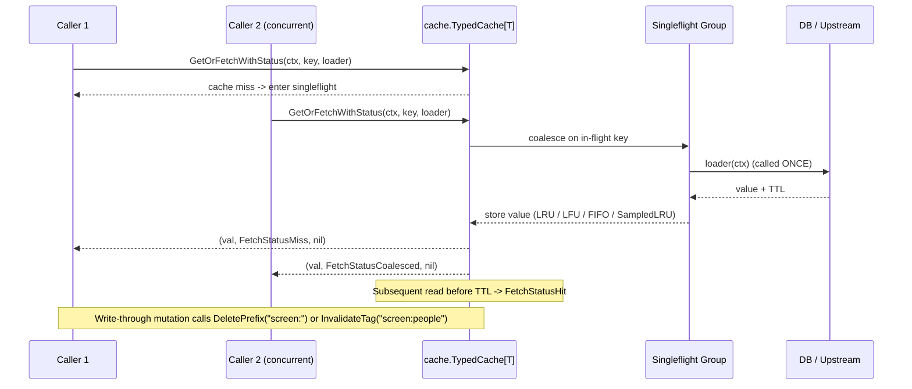
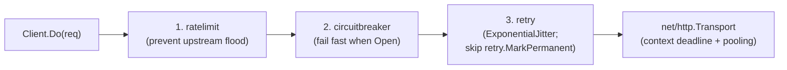

# End-to-End Execution Flows — `go-libs` (`v0.6.0`)

> **Step 3 of the Mandatory Grounding Order** (`AGENTS.md` -> `docs/ARCHITECTURE.md` -> **`docs/FLOWS.md`** -> `skills/*/SKILL.md` -> `docs/CODEGRAPH.md` -> targeted source reads only for verification).

This document traces the canonical runtime flows across `github.com/abeta-dev/go-libs` (`v0.6.0`, Go `1.26.0`) so engineers and AI coding agents understand execution ordering, context propagation, failure boundaries, and state lifecycles before modifying any package.

---

## 1. Inbound HTTP / Gin & Stdlib `net/http` Middleware Pipeline

Both [`ginmw`](../ginmw/README.md) (31 Gin helpers) and [`httpmw`](../httpmw/README.md) (zero-Gin, zero-`pgx`, zero-OTel stdlib `net/http` parity) enforce the same defense-in-depth ordering so identity, tracing, panic recovery, security headers, and rate limits execute in deterministic sequence:

### Ordering Invariants
- **`requestid` before `logger` & `recovery`**: Guarantees every error log and panic response carries a correlated `X-Request-ID`.
- **`securityheaders` & `loopbackguard` before `compress` & handlers**: Local desktop/edge BFFs disable HSTS with `securityheaders.WithDisableHSTS()` and set `securityheaders.WithCacheControl("private, no-cache")` when pairing with `etag`.
- **`compress` excludes `text/event-stream`**: Streaming SSE responses bypass dynamic compression buffering automatically so tokens flush immediately.
- **`etag` hashes canonical JSON**: Configured JSON keys (e.g., `cached_at_iso`, `generated_at_iso`) are excluded before hashing; `X-Client-App-Version` mismatch auto-busts `If-None-Match` and returns `200 OK` with fresh `X-App-Version` and `X-Page-Version`.

---

## 2. Stampede-Protected Caching & Tag/Prefix Invalidation (`cache`)

- Use `SetWithTags` / `GetOrFetchWithTags` + `InvalidateTag` / `InvalidateTags` or `DeletePrefix` on mutation paths to drop dependent view keys atomically.
- Emit `FetchStatus` (`HIT`, `MISS`, `COALESCED`) directly into diagnostic headers (e.g., `X-BFF-Cache`).

---

## 3. SSE Streaming & Precompressed Static/SPA Delivery (`sse`, `compress`)

### Server-Sent Events (`sse` / `ginmw.SSE`)
1. Handler upgrades response via `sse.NewStream(w, r)` (validates `http.Flusher`, sets `Content-Type: text/event-stream`, `Cache-Control: no-cache`, `X-Accel-Buffering: no`).
2. Reads optional `Last-Event-ID` header for client resume semantics.
3. Optional heartbeat loop sends `: keepalive\n\n` comments on the configured interval to prevent proxy idle timeouts.
4. `Send(sse.Event{ID, Event, Data, Retry})` writes framed SSE payloads and immediately flushes; exits cleanly when `r.Context().Done()` fires.

### Precompressed Static / SPA Assets (`compress.PrecompressedFileServer`)
1. Cleans request path and prevents traversal outside `rootDir`.
2. Negotiates `Accept-Encoding` (`br` -> `gzip` -> raw file) and checks for build-time `<file>.br` / `<file>.gz` sidecars with `Vary: Accept-Encoding`.
3. For unmatched SPA client routes (non-asset paths), falls back to `index.html` with optional `<meta name="csrf-token" ...>` injection when paired with `loopbackguard`.

---

## 4. Local-First Loopback Security & CSRF Guard (`loopbackguard`)

1. **Bind-address validation**: `ValidateLoopbackAddr(addr)` refuses non-loopback listeners before `net.Listen`.
2. **DNS-rebinding defense**: Request `Host` header must match the configured loopback allowlist (`127.0.0.1`, `localhost`, `[::1]`).
3. **Browser fetch metadata & origin check**: Rejects cross-site requests via `Sec-Fetch-Site` and `Origin` verification.
4. **State-changing CSRF verification**: Mutating methods (`POST`, `PUT`, `PATCH`, `DELETE`) require constant-time match against the per-boot ephemeral token (`X-CSRF-Token` header).

---

## 5. Outbound Resilient HTTP Client (`httpclient`)

Outbound requests compose three resilience barriers in strict inside-out order:

- Permanent 4xx errors are wrapped with `retry.MarkPermanent(err)` so retries abort immediately without tripping retry budgets.
- `circuitbreaker` trips on consecutive or ratio failures, transitions `Closed` -> `Open` -> `HalfOpen`, and probes recovery safely.

---

## 6. Database Transactions & Embedded SQLite WAL (`db`, `sqlite`)

### PostgreSQL (`db`)
1. `db.Connect(ctx, cfg)` configures a `pgxpool.Pool` with health ping and pool bounds.
2. `db.WithTx(ctx, pool, fn)` starts a transaction (or a nested `SAVEPOINT` if already inside a transaction in `ctx`) and binds the active `DBTX` via `db.WithQuerier`.
3. Panic or non-nil error triggers guaranteed rollback; nil return commits cleanly.

### Embedded SQLite (`sqlite`)
1. `sqlite.Open(ctx, dsn, opts...)` enforces WAL journal mode, `busy_timeout`, foreign keys, and `synchronous=NORMAL` (driver-agnostic via `WithDriver`).
2. `(*sqlite.DB).Migrate(ctx, migrations)` applies monotonic `PRAGMA user_version` schema migrations inside `BEGIN IMMEDIATE` write transactions.
3. `(*sqlite.DB).WithImmediateTx(ctx, fn)` acquires write locks upfront to avoid mid-transaction `SQLITE_BUSY` deadlocks.
4. `(*sqlite.DB).Backup(ctx, destPath)` creates a consistent atomic snapshot via `VACUUM INTO`.

---

## 7. Bounded Concurrency & Graceful Shutdown (`workerpool`, `shutdown`)

1. Background work executes via `workerpool.New(workers, queueSize)` (never unbounded `go func()`), propagating context cancellation and routing panics to `WithPanicHandler`.
2. `shutdown.New(shutdown.WithTimeout(d))` listens for `SIGINT` / `SIGTERM`, then runs registered teardown hooks in deterministic order:
   1. Mark `health` readiness probe unready.
   2. Drain HTTP server (`srv.Shutdown(ctx)`).
   3. Stop `workerpool` and flush async telemetry/logs.
   4. Close PostgreSQL (`db`) or SQLite (`sqlite`) pools.
